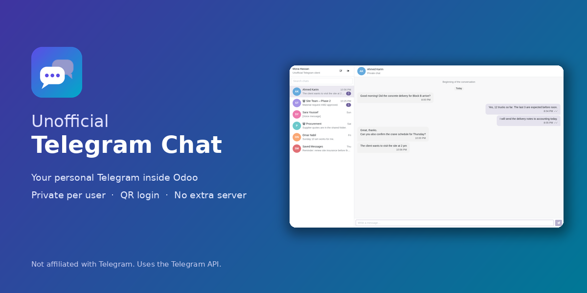
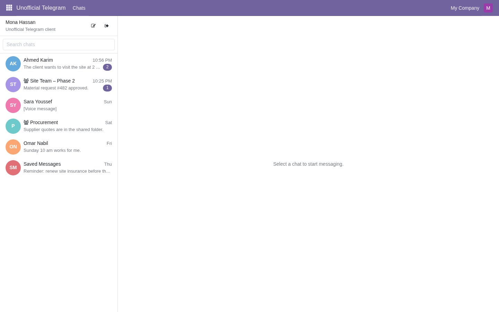
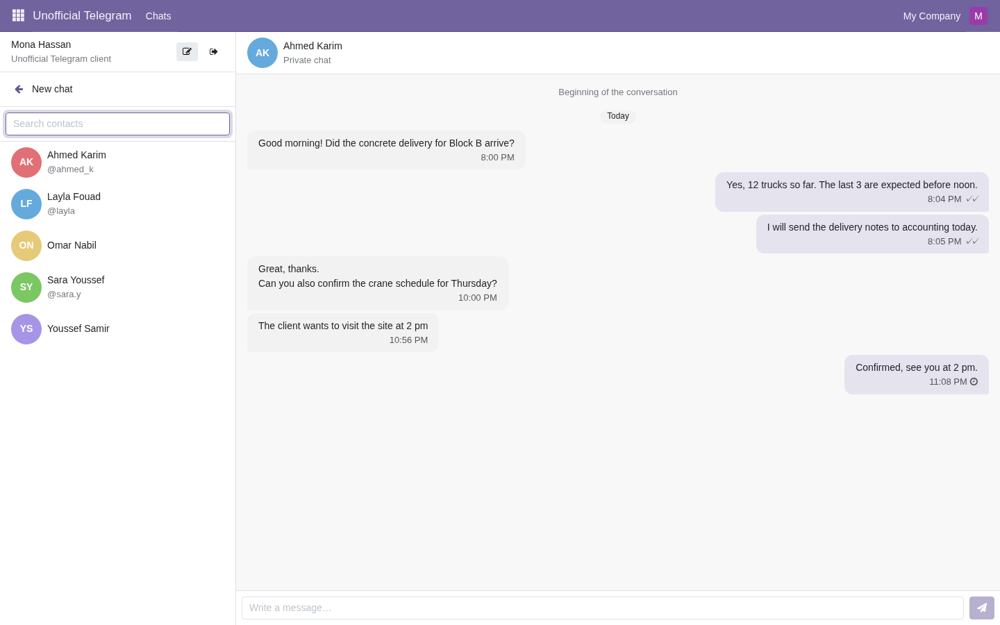
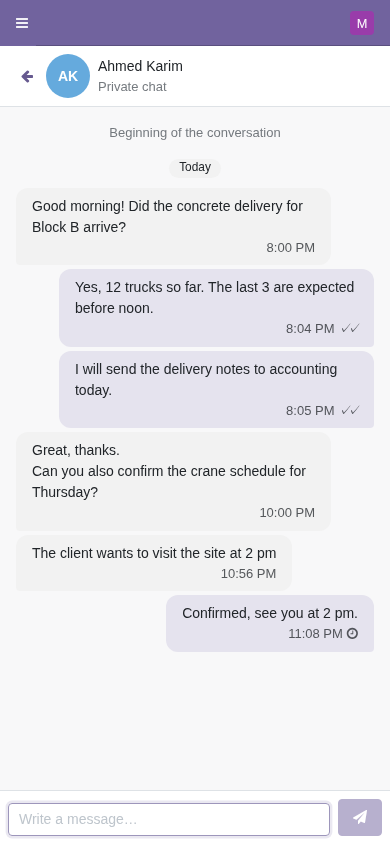
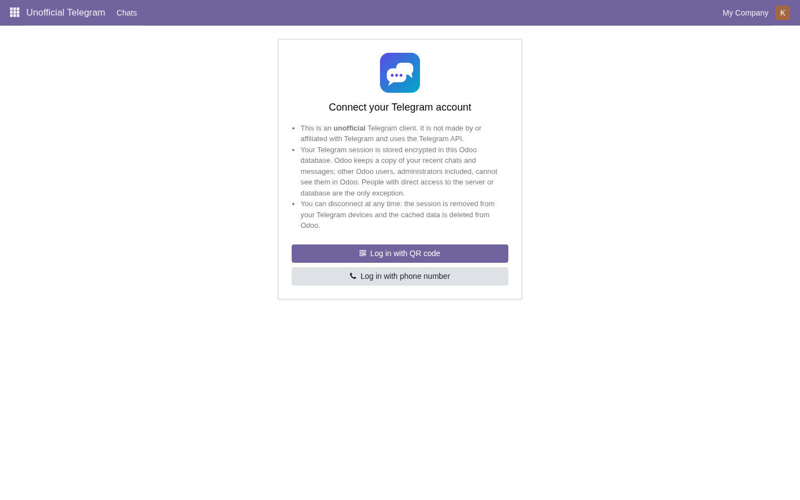
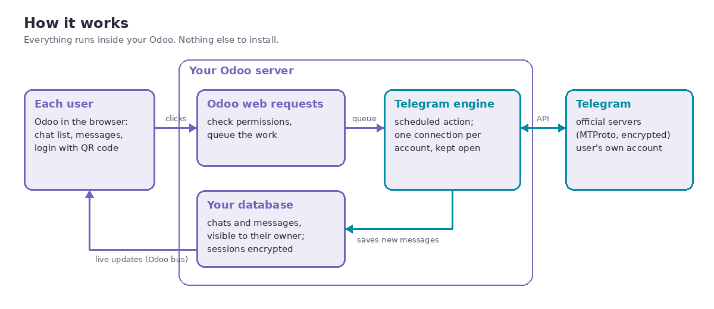

# Unofficial Telegram Chat for Odoo 19

Each Odoo user connects **their own personal Telegram account** and chats from inside Odoo,
like Telegram Desktop. Everything runs inside Odoo: no extra server, no Docker, no `pip install`.

> **Unofficial client.** Not made by, endorsed by or affiliated with Telegram. It uses the
> Telegram API with each user's own account.



- **Module:** `telegram_personal_client` · **Odoo:** 19.0 (tested on Community) · **License:** OPL-1 · **Price:** 79 EUR on the Odoo Apps Store

---

## Contents

1. [Features](#features)
2. [How it works](#how-it-works)
3. [Requirements](#requirements)
4. [Installation](#installation)
5. [Administrator setup](#administrator-setup)
6. [User guide](#user-guide)
7. [Security and privacy](#security-and-privacy)
8. [Telegram's rules and account safety](#telegrams-rules-and-account-safety)
9. [Limitations](#limitations)
10. [Troubleshooting](#troubleshooting)
11. [FAQ](#faq)
12. [Publishing on the Odoo Apps Store](#publishing-on-the-odoo-apps-store)
13. [Development](#development)
14. [License](#license)

---

## Features

| | |
|---|---|
| **Personal accounts** | Every Odoo user connects their own Telegram account: QR code (scan with the phone) or phone number + login code + two-step password. |
| **Chat list** | Search, unread counts, pinned chats, profile photos, last-message previews. |
| **Conversations** | Private chats and groups; history loads as you scroll up; send text (Enter sends, Shift+Enter new line); sent ✓ / read ✓✓ ticks; failed sends can be retried. |
| **Live** | New messages, edits, deletions and read receipts appear by themselves. |
| **Contacts** | Start a chat with anyone in your Telegram address book. |
| **Phone layout** | One pane at a time with a back button. |
| **Administration** | Connection status of every account (no access to messages), force disconnect, settings, message-cache retention. |
| **Translatable** | 273 strings in `i18n/telegram_personal_client.pot`. |

| Chat list | Contacts | Phone | Login |
|---|---|---|---|
|  |  |  |  |

---

## How it works



### The communication, step by step

1. **The browser talks only to Odoo.** The Telegram screen is an Odoo client action (OWL). Every
   action, such as opening a chat, sending a message or submitting a login code, is a JSON-RPC
   request to Odoo (`/telegram/*` routes).
2. **Odoo checks and queues.** The route always works on the *caller's own* account (it never
   accepts an account or user id), checks the record rules, validates the input, and stores a
   **command** (`telegram.command`). Login codes and passwords are stored **encrypted** in the
   command and deleted as soon as they are read.
3. **The Telegram engine does the talking.** A scheduled action, *Telegram: Engine*, runs inside
   Odoo's cron worker. It keeps **one Telethon client per connected account**, connected to
   Telegram's official servers over MTProto (Telegram's encrypted protocol), and:
   - picks up queued commands about twice a second (a new command also wakes it up immediately),
   - receives updates (new/edited/deleted messages, read receipts) as they happen,
   - fetches what was missed while it was not connected (Telegram's catch-up), from the saved update state.
4. **Results go to the database and to the screen.** The engine stores chats, messages and
   contacts (each visible only to its owner) and pushes changes to the owner's open screens
   through Odoo's bus (the same live channel Odoo Discuss uses).
5. **Sessions are kept.** The Telegram session (authorization key, data center, update state) is
   saved **encrypted** on the account, so users stay connected across restarts and upgrades.

### Why a scheduled action

Telegram ends a session that is used from two connections at the same time
(`AUTH_KEY_DUPLICATED`). Odoo runs several web workers, so they must never connect to Telegram.
Odoo locks a cron job while it runs, which guarantees **exactly one engine per database**. The
engine works in windows of about 45 seconds (well inside Odoo's cron time limit) and starts the
next window immediately while accounts are connected, with a low priority so all other
scheduled actions run first.

**Latency:** about 1–2 seconds while the engine runs; messages that arrive in the short gap
between two windows are fetched at the start of the next one.

### What is stored where

| Data | Where | Who can read it through Odoo |
|---|---|---|
| Telegram session | `telegram.account.session_data`, encrypted (Fernet, key from `TELEGRAM_SESSION_KEY` or the database secret, bound to the database uuid) | Nobody (engine only) |
| Login codes / 2FA passwords | Encrypted in a queued command, deleted when read | Nobody |
| Chats, messages, contacts | `telegram.chat`, `telegram.message`, `telegram.contact` | The owner only (global record rules) |
| Connection status | `telegram.account` | The owner and Telegram administrators of the same company |
| API ID / API hash | System parameters or server environment variables | Settings administrators (hash is write-only in the form) |

Nothing is sent anywhere except to Telegram. The app has no telemetry and no license server.

---

## Requirements

- Odoo **19.0** (tested on Community: on-premise, single and multi-worker servers).
  Enterprise and Odoo.sh: see [docs/RELEASE_CHECKLIST.md](docs/RELEASE_CHECKLIST.md) for their test status.
- A **Telegram API ID and hash** for your company (free, from my.telegram.org).
- **Outbound internet** from the Odoo server to Telegram (TCP 443).
- **Cron workers ≥ 2** (`max_cron_threads`, Odoo's default is 2).
- Python packages: none to install. `qrcode` and `cryptography` come with Odoo; the Telegram
  library (Telethon 1.45.0, MIT) and its dependencies are bundled in
  `telegram_personal_client/lib/`.
- **Not available on Odoo Online** (SaaS): Odoo does not allow third-party Python modules there.

---

## Installation

### On-premise / VPS

1. Copy the `telegram_personal_client` folder into one of your Odoo addons paths.
2. Restart Odoo, then **Apps › Update Apps List**.
3. Search for **Unofficial Telegram Chat** and click **Activate**.

Command line equivalent:

```bash
odoo -d <database> -i telegram_personal_client --stop-after-init
```

### Docker (official `odoo:19.0` image)

```yaml
services:
  odoo:
    image: odoo:19.0
    volumes:
      - ./addons:/mnt/extra-addons          # put telegram_personal_client in ./addons
    environment:
      TELEGRAM_SESSION_KEY: ${TELEGRAM_SESSION_KEY}   # recommended, see below
      TELEGRAM_API_ID: ${TELEGRAM_API_ID}             # optional (or set in Settings)
      TELEGRAM_API_HASH: ${TELEGRAM_API_HASH}         # optional (or set in Settings)
```

Put the values in a `.env` file next to `docker-compose.yml` (never in Git).

### Upgrading the module

Upgrade with Odoo stopped, or at startup (`odoo -d <database> -u telegram_personal_client`).
The engine runs almost all the time and Odoo does not let a running scheduled action be
modified. Sessions are kept across upgrades.

---

## Administrator setup

### 1. Get the Telegram API ID and hash (once per company)

1. Open **https://my.telegram.org** and log in with a phone number of your company (Telegram
   sends a code to that account's Telegram app).
2. Click **API development tools**.
3. Fill in the form: *App title* (any name, e.g. "Company Odoo"), *Short name* (5–32 letters),
   platform *Desktop*. Submit.
4. Copy the **App api_id** (a number) and **App api_hash** (32 characters).

One API ID serves every user of the database. Telegram allows one API ID per phone number.
Keep the hash private, like a password.

### 2. Enter them in Odoo

**Unofficial Telegram › Configuration › Settings** (or *Settings › Unofficial Telegram*):

| Setting | What to do |
|---|---|
| **API ID** | Paste the api_id. |
| **API Hash** | Paste the api_hash. It is write-only: Odoo never shows it again. Alternative: set `TELEGRAM_API_HASH` (and `TELEGRAM_API_ID`) in the server environment; the setting then shows "Set by environment variable". |
| **Test Servers** | Leave **off**. Only for developers with Telegram test accounts. |
| **Session Encryption** | Shows which key protects sessions. "Database secret (weaker)" means `TELEGRAM_SESSION_KEY` is not set. |
| **Message Cache** | Days to keep cached messages in Odoo (0 = keep). Messages stay in Telegram. |
| **Last Engine Run** | When the Telegram engine last ran: a quick health check. |

### 3. Set the session key (recommended)

Generate a random key and add it to the Odoo server's environment, then restart Odoo:

```bash
python3 -c "import secrets; print(secrets.token_urlsafe(32))"
```

- Docker: `TELEGRAM_SESSION_KEY` in the service `environment` (see [Installation](#installation)).
- systemd: `systemctl edit odoo`, then add `Environment=TELEGRAM_SESSION_KEY=<key>` under `[Service]`.

Keep a copy in your password manager. With this key, a copy of the database alone cannot open
anyone's Telegram session. If it is lost or changed, users simply connect again.

### 4. Give access to users

In **Settings › Users**, set **Unofficial Telegram** to:

- **User**: can connect and use their own Telegram account.
- **Administrator**: additionally sees *Configuration › Accounts* (connection status of every
  account in their companies, no access to messages) and can **Force Disconnect** an account,
  for example when an employee leaves. Archived users, and users who lose the User right, are
  logged out automatically within about 30 seconds.

### 5. Check the engine

**Settings › Technical › Scheduled Actions › Telegram: Engine** must be active. The
*Last Engine Run* in the Telegram settings should be recent once someone uses the app.

---

## User guide

### Connect your account

1. Open **Unofficial Telegram** from the Odoo home screen.
2. Read the short notice, then choose:
   - **Log in with QR code** (recommended): on your phone open Telegram → **Settings › Devices ›
     Link Desktop Device** and scan the code shown in Odoo. The code refreshes automatically.
   - **Log in with phone number**: enter your number in international format (e.g.
     `+20 123 456 7890`), then the code Telegram sends to your Telegram app (or by SMS).
3. If your account has two-step verification, enter your password (the hint is shown).

Telegram shows a normal "new login" notice on your other devices; the session appears there as
"Odoo".

### Use it

- **Chats:** click a chat; scroll up to load older messages. Unread chats show a badge.
- **Send:** type and press **Enter** (Shift+Enter for a new line). A clock means "sending",
  ✓ "sent", ✓✓ "read". If sending fails, click **Retry**.
- **New chat:** the pencil button opens your Telegram contacts.
- **Search:** filters chats by name and last message.
- Photos, files and voice messages appear as labelled placeholders: open Telegram to view them.

### Disconnect

Click the exit button next to your name and confirm. The session is removed from your Telegram
devices and your cached chats are deleted from Odoo. Your messages stay in Telegram.

---

## Security and privacy

- **Owner only:** global record rules on chats, messages and contacts; no group, administrators
  included, can read another user's Telegram data through Odoo. Verified by automated tests,
  including forged record ids over RPC.
- **Secrets hidden from everyone:** session, QR link, login attempts, 2FA hint and queued
  commands use `groups=NO_ACCESS`; only the engine (superuser) uses them.
- **Encryption at rest:** sessions and queued codes/passwords are encrypted. Keys are bound to
  the database uuid: a duplicated database cannot open the original's sessions; neutralized
  databases (staging, `odoo neutralize`) drop all sessions (`data/neutralize.sql`).
- **No secrets in logs:** phone numbers, codes and passwords are never logged (tested).
- **Untrusted content:** message text is always rendered as plain text, never HTML.
- **Honest limitation:** people with direct access to the server or the database are outside
  Odoo's permission system. With `TELEGRAM_SESSION_KEY` set, the database alone is still not
  enough to open sessions.

---

## Telegram's rules and account safety

Telegram monitors accounts that use third-party apps. This app is built to behave like a person
using Telegram Desktop:

- Every message is sent by a person clicking *Send*: no bulk messaging, auto-replies,
  scheduling or member scraping. **It cannot be used for marketing campaigns.**
- Online status only while the Telegram screen is open; read receipts only when a chat is opened.
- Telegram's flood limits are obeyed ("Telegram asked to wait N seconds").
- Login attempts are capped below Telegram's limits: 3 code requests per day, 5 code or
  password checks per hour, 10 QR starts per hour per account.
- One persistent connection per account; no repeated logins.
- Honest device information ("Odoo"); never pretends to be an official Telegram app.
- Each company uses its own API ID, as Telegram's terms require.
- Broadcast channels are not shown (Telegram requires sponsored-message support for apps that
  show channel content).
- Telegram data is never used for AI features (Telegram's terms forbid it).

Tips: use established accounts with real SIM numbers (brand-new or virtual numbers are restricted
far more often), and keep Odoo on a stable server.

---

## Limitations

- Photos, files, voice and video messages are shown as placeholders; sending them is not
  supported yet.
- Broadcast channels, secret chats and calls are not shown.
- The chat list starts with your 100 most recent chats (archived chats excluded); older chats
  appear when they receive a message.
- One Telegram account per Odoo user.
- Dark mode is an Odoo Enterprise feature (Community always uses the light theme).
- Some accounts cannot log in from third-party apps until a login email is set in the official
  app; the app explains this.

---

## Troubleshooting

| Symptom | Cause and fix |
|---|---|
| "The Telegram API credentials are not configured yet" | Enter API ID and hash in Settings (or the environment variables). |
| Login stays on "Contacting Telegram…" | The engine is not running: check the *Telegram: Engine* scheduled action is active, `max_cron_threads` ≥ 1 (2 recommended), and the server can reach Telegram. *Last Engine Run* shows the last run. |
| "The Telegram API credentials are invalid" | Wrong API ID or hash: copy them again from my.telegram.org. |
| Login code never accepted | Check **Test Servers** is **off** in Settings (test servers only work with Telegram test accounts). |
| "Telegram asked to wait N seconds" | Telegram's flood limit: wait and retry. |
| "Too many attempts" | The app's protective login caps: wait the indicated time. |
| "This Telegram session was ended…" | The session was ended from another device: connect again. |
| "…session key changed" | `TELEGRAM_SESSION_KEY` changed or the database was copied: connect again. |
| "Set it up in the official Telegram app first" | New accounts may need a login email set in the official app first. |
| Account limited by Telegram | Message `@SpamBot` in Telegram; wrongful bans: email recover@telegram.org (written by a person). |
| Upgrade error "This cron task is currently being executed" | Upgrade with Odoo stopped, or at startup. |
| Chats do not update live | Check Odoo's live channel (websocket) works: behind a reverse proxy, route `/websocket` to Odoo's gevent port in multi-worker mode. |

---

## FAQ

**Is this a Telegram bot?** No. Each user connects their own personal account, with their own
chats and contacts.

**Do messages go through your servers?** No. Only your Odoo and Telegram's servers.

**Can a manager read employees' messages?** Not through Odoo. Administrators see connection
status only and can force a disconnect.

**Does it work without the user's phone?** Yes, once connected. The phone is only needed to log
in (QR scan or code).

**What if Odoo restarts?** Users stay connected; messages that arrived meanwhile are fetched
when the engine starts again.

**Can we use it for marketing or bulk messages?** No. That is against Telegram's terms and gets
accounts banned; the app deliberately has no such feature.

**How many users?** Any number; there is no per-user fee. Each connected account uses one
connection held by the engine; measure with your own load before connecting hundreds of accounts.

---

## Publishing on the Odoo Apps Store

For the vendor (this repository's owner):

1. **Repository:** this repository, branch **`19.0`**, module folder at the root. The Apps Store
   only packages folders that contain a `__manifest__.py`; `docs/` and `dev/` are ignored.
2. **Private repository:** on GitHub, *Settings › Collaborators › Add people* → **`online-odoo`**
   (read access), so Odoo can read the code without making it public.
3. **Register:** on apps.odoo.com, log in with your Odoo account, open *Publish your apps*
   (vendor area) and add the repository as `ssh://git@github.com/gamalmouhssine/odoo-unofficial-telegram-chat.git#19.0`.
   Odoo scans it and creates the app page from `static/description/index.html`, the icon,
   the cover (`images` key) and the price.
4. **Price:** `price` / `currency` in `__manifest__.py` (currently 79 EUR). It must be the
   lowest price you sell the app for anywhere; Odoo keeps 30%.
5. **Before publishing:** complete [docs/RELEASE_CHECKLIST.md](docs/RELEASE_CHECKLIST.md)
   (Enterprise and Odoo.sh tests, vendor details, confirmation from apps@odoo.com about the
   bundled pure-Python libraries).
6. **Updates:** push to `19.0` with a higher `version` in the manifest; the store picks it up.

---

## Development

```
telegram_personal_client/   the Odoo module (shipped)
├── engine/                 Telegram runtime: cron engine, sessions, encryption, sync
├── models/ controllers/ views/ security/ data/ migrations/
├── static/src/             OWL screen (chat list, conversation, contacts, login wizard)
├── lib/                    bundled Telethon, pyaes, rsa, pyasn1 (+ licenses, VENDORED.md)
└── tests/                  66 automated tests (fake Telegram, no network)
docs/                       architecture plan and release checklist
dev/                        browser check (Playwright), multi-worker check, demo data, store images
```

Run the tests in a throw-away database:

```bash
odoo -d tg_test -i telegram_personal_client --test-tags /telegram_personal_client --stop-after-init
```

Browser check, multi-worker check, translation export and store images: see
[dev/README.md](dev/README.md).

---

## License

The module is licensed under the **Odoo Proprietary License v1.0** ([LICENSE](LICENSE)):
use requires a purchase (typically via the Odoo Apps Store); redistribution is not allowed.
Bundled libraries keep their own licenses: Telethon (MIT), pyaes (MIT), rsa (Apache-2.0),
pyasn1 (BSD-2-Clause); see `telegram_personal_client/lib/LICENSES/`.

Telegram is a trademark of its owner; this project is not affiliated with Telegram.
